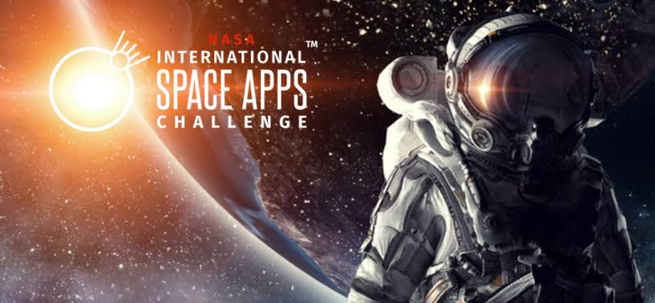
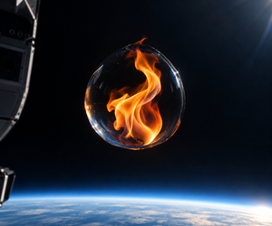

<div align="center">

# 🔥 Flame in Freefall

### Explore how fire behaves when gravity lets go.

**NASA research → traceable experiments → scientific insight**

An independent NASA Space Apps Challenge 2026 project<br>
**Team: Not Exactly Rocket Science, Is It?!**



[Explore the science](#the-science-we-can-support) · [Judge journey](#a-three-minute-judge-journey) · [Run the app](#run-locally) · [Source and verification](#evidence-you-can-inspect)

</div>

---

## Why this matters

Fire safety in space begins with understanding combustion under unfamiliar conditions. NASA's investigations contain valuable evidence, but report tables, experiment identifiers, missing measurements, and technical terminology can make that evidence difficult to explore.

**Flame in Freefall turns a verified subset of NASA research into one connected investigation:** discover a test, inspect its measurements, compare reported relationships, ask a source-grounded question, explore engineering considerations, and interact with a clearly bounded mathematical model.

## One investigation. Six connected workspaces.

| Workspace | What a visitor can do |
| --- | --- |
| **Research Explorer** | Discover investigations, scientific topics, and source records; begin with a verified FLEX example. |
| **Research Records** | Filter actual report-extracted tests, inspect original values and units, follow provenance, and run restricted read-only SQL. |
| **Compare & Analyze** | Plot descriptive relationships with original axis units, missing-value counts, and traceable experiment records. |
| **AI Research Assistant** | Ask a research question, inspect retrieved evidence, and view optional citation-checked Groq explanations. |
| **Solution Lab** | Connect a research question to supporting observations and conditional engineering considerations. |
| **View Effect** | Load compatible report parameters or illustrative inputs into a D-squared droplet model, then play, pause, and reset its calculated trajectory. |

The selected experiment and relevant question travel between workspaces through session context.

## A three-minute judge journey

1. Open **Research Explorer** and select **Start with a verified FLEX experiment**.
2. Inspect **FLEX–054** in Research Records: original measurement tokens, missing cells, and the NASA report citation remain accessible.
3. Select **Compare values** to see its initial diameter and reported burn duration with units.
4. Select **Ask about this test**, submit the question, and expand the evidence citation.
5. Continue to **Explore solutions** to examine the supporting research.
6. Select **Open droplet model**, load the compatible D₀ and K values, and press **Play**.

The reported burn duration and calculated model endpoint appear separately, so visitors can see where observation ends and mathematical interpretation begins.

## The science we can support

| Verified corpus | Included scope |
| --- | ---: |
| FLEX report-extracted tests | **273** |
| Original measurement cells, including unavailable-value markers | **2,457** |
| Searchable PDF page passages | **329** |
| Source-linked documentary notes | **10** |
| Catalogued sources | **25** |

The numerical dataset is a validated transcription subset of **NASA/TP-2015-216046**, Appendix A, Table IX. Original units, printed values, page references, missing values, and data classifications are preserved.

These records are classified **NASA_REPORT_EXTRACTED**. They are a subset of the report's experiments; original NASA PSI telemetry has not been acquired. BASS-II, SAME, and Saffire provide research context, with no admitted numerical experiment rows in this release.

### A model with visible boundaries

```text
D(t)² = D₀² − Kt

D₀: initial liquid-droplet diameter [mm]
K:  constant burning-rate parameter [mm²/s]
t:  model elapsed time [s]
```

Python calculates the diameter curve and drives the schematic object's size. The warm core and halo are **schematic flame visualization**, not an experimentally observed flame image or a prediction of flame geometry.

The model assumes constant K. NASA's reported D₀ and fitted K use different time references, so loading source values produces a teaching approximation. It does not predict flame extinction, oxygen effects, or spacecraft safety. Compatible source loading is available for **258 of the 273** admitted tests; other records retain a clear explanation and illustrative mode.

<div align="center">



*Supplied conceptual artwork — not experimental footage.*

</div>

## Evidence you can inspect

Every scientific view keeps its evidence close:

- Original test identifiers, units, measurement classifications, and report pages.
- Missing values shown explicitly and excluded from chart pairs where needed.
- Separate source observations, calculated model values, and engineering interpretations.
- Bounded SQLite FTS5 retrieval with inspectable citations.
- Optional AI output checked against retrieved citation IDs and numerical tokens.

Citation checks are heuristic; visitors should inspect the underlying sources. Without a Groq key, the app remains usable in deterministic evidence mode. **No authenticated live Groq call has been verified in this project session.**

Primary scientific references:

- [NASA FLEX detailed-results report](https://ntrs.nasa.gov/citations/20150023456)
- [NASA technical reference supporting the D-squared model](https://ntrs.nasa.gov/citations/19820015544)
- [NASA PSI FLEX investigation](https://psi.nasa.gov/physci/repo/data/investigations/PSI-69)

## Built for transparent scientific exploration

**Python 3.12 · Streamlit · SQLite FTS5 · Pandas · NumPy · Plotly · optional Groq**

The database is opened read-only. Restricted SQL uses approved projections, row and execution limits, and an SQLite authorizer. Simulation outputs are never written into the verified corpus.

```text
app.py                  Six connected research workspaces
backend/                Data access, analysis, retrieval, AI checks, simulation
data/                   Compressed verified SQLite corpus
assets/                 Supplied astronaut and flame artwork
tests/                  Scientific and service verification
research/               Source admission and checkpoint reports
```

## Run locally

Use Python 3.12 and check out **phase3-integration**:

```sh
git clone --branch phase3-integration https://github.com/Dark-AI619/Not-Exactly-Rocket-Science-is-it-Flame-in-Free-Fall-2026-Nasa-Space-Apps-.git
cd Not-Exactly-Rocket-Science-is-it-Flame-in-Free-Fall-2026-Nasa-Space-Apps-
python -m venv .venv
```

Activate the environment, then:

```sh
python -m pip install -r requirements.txt
python -m streamlit run app.py
```

No API key is required for evidence mode. For optional generation, the owner can configure `GROQ_API_KEY` privately in Streamlit secrets or environment variables. Non-secret controls are documented in [.env.example](.env.example). Never commit a key. The per-session request budget does not cap aggregate usage across public visitors.

### Owner deployment

Deploy from **branch `phase3-integration`**, entry point **`app.py`**, using Python 3.12. The required database and artwork are committed. The default `main` branch contains an earlier preview and does not contain this completed simulation.

Deployment and final live Groq verification remain owner-controlled. A previously published demo may show the earlier preview until the owner redeploys.

## Verification

The Phase 5 acceptance run passed **70 automated tests**, compilation, database validation, and a local browser journey across all six workspaces. The final visual pass passed **17 targeted simulation tests** and local inspection of Explorer, Assistant, comparison charts, and the shrinking schematic droplet.

```sh
python -m pip install -r requirements-dev.txt
python -m pytest tests -q
```

[Final acceptance report](research/PHASE5C_REPORT.md) · [Model assumptions and verification](research/PHASE5B_REPORT.md) · [Source admission architecture](research/ADMISSION_ARCHITECTURE.md)

## Team, attribution, and responsible use

Created by **Not Exactly Rocket Science, Is It?!** for NASA Space Apps Challenge 2026. This is an independent project; NASA does not operate or endorse the dashboard.

NASA sources are linked through the research catalogue with recorded provenance and rights status. The owner supplied the astronaut/Space Apps and flame-over-Earth artworks; their inclusion does not grant downstream reuse rights. Source-specific rights must be checked before redistribution.

ChatGPT/Codex assisted with data preparation, software implementation, and interface design. Scientific claims remain bounded by the admitted evidence and documented model assumptions.

---

<div align="center">

**Follow the experiment. Inspect the evidence. Understand the limits.**

</div>
